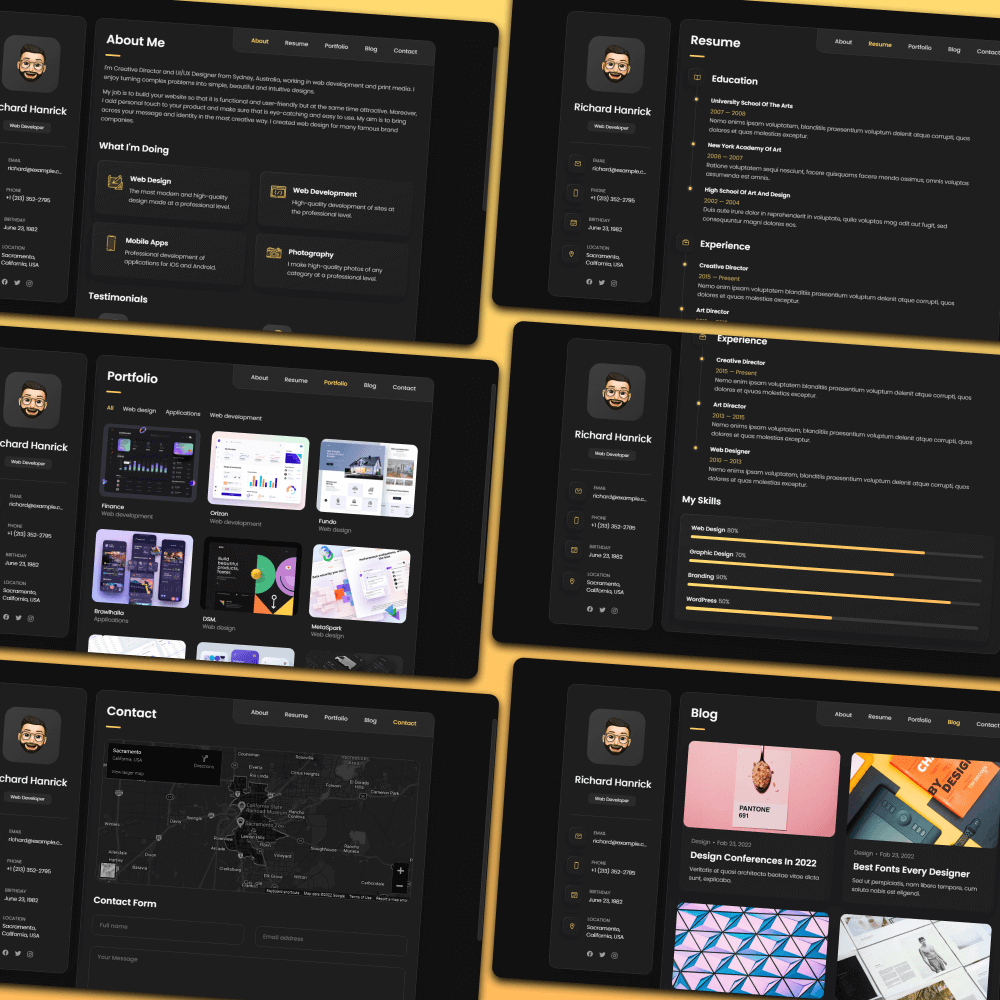
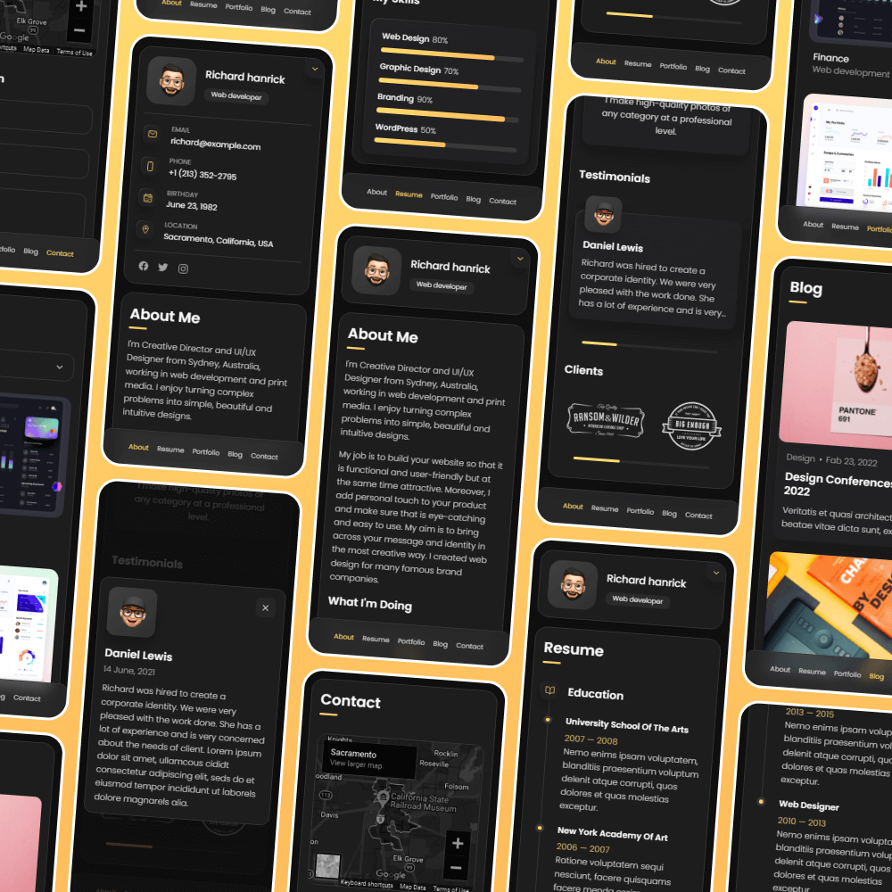

<div align="center">

# 🚀 Yash Kushwaha's Portfolio

**A sleek, modern, and fully responsive personal portfolio for a Mobile App Developer.**

Showcasing 2+ years of expertise in cross-platform mobile development (Flutter, iOS, Android) through a highly polished web interface.


</div>

---

## 🌟 Introduction

Welcome to the source code of my personal portfolio! This project is a carefully crafted online resume and work showcase, designed to be blazing fast, visually stunning, and highly intuitive. 

**Who is this for?**
- **Recruiters & Engineering Managers** looking for a passionate Mobile App Developer.
- **Freelance Clients** seeking high-quality Flutter, Node.js, and Firebase solutions.
- **Developers** looking for a clean, structure-driven HTML/CSS/JS portfolio template.

**Core Value Proposition:**
Instead of relying on heavy JavaScript frameworks, this portfolio utilizes purely semantic HTML5, modern vanilla CSS3, and lightweight vanilla JavaScript to deliver a premium user experience without any bloat.

## ✨ Features

| Feature | Description |
| :---: | :--- |
| 📱 **Mobile-First Design** | Fully responsive layout that looks perfect on desktops, tablets, and smartphones. |
| 🎨 **Modern UI/UX** | Features custom typography, smooth transitions, and a clean, startup-grade aesthetic. |
| 🗂️ **Filterable Portfolio** | Dynamic project gallery allowing users to filter by Mobile Designs, Apps, and Web. |
| 📜 **Interactive Timeline** | Beautifully styled education and experience roadmap for easy scanning. |
| 💬 **Testimonial Modals** | Custom-built popup modals to display client reviews interactively. |
| ⚡ **Extreme Performance** | Zero dependency UI ensuring instant load times and optimal SEO. |

## 📸 Screenshots & Demo

A picture is worth a thousand words. Here is how the portfolio looks across different devices:

### Desktop View


### Mobile View


## 🛠 Tech Stack

Built with a focus on core web technologies to guarantee speed and ease of customization:

- **Frontend Structure:** `HTML5` (Semantic elements for accessibility)
- **Styling:** `CSS3` (Custom variables, flexbox, CSS grid, media queries)
- **Interactivity:** `Vanilla JavaScript` (ES6+, DOM manipulation, Event Listeners)
- **Icons:** `Ionicons` (Lightweight SVG icons)
- **Fonts:** `Google Fonts` (Poppins)

## 🚀 Getting Started

Running this project locally is incredibly simple. No build steps or package managers required.

### Prerequisites
- [Git](https://git-scm.com/downloads) installed on your machine.
- A modern web browser (Chrome, Firefox, Safari, Edge).

### Installation Steps

1. **Clone the repository:**
   ```bash
   git clone https://github.com/tricker3333/Portfolio_Yash.git
   ```

2. **Navigate to the project directory:**
   ```bash
   cd Portfolio_Yash
   ```

3. **Run the application:**
   Simply double-click on `index.html` to open it in your default web browser, or use a live server extension in VS Code for hot-reloading.

## 📁 Project Structure

```text
Portfolio_Yash/
├── assets/
│   ├── css/
│   │   └── style.css            # Main stylesheet handling layout and themes
│   ├── images/                  # Avatars, logos, and UI graphics
│   └── js/
│       └── script.js            # Interactivity (filtering, modals, sidebar)
├── website-demo-image/          # Contains screenshots for this README
├── index.html                   # Main entry point 
├── index.txt                    # Text backup of portfolio content
├── LICENSE                      # Project License
└── README.md                    # You are here!
```

## 🧠 Design Philosophy

- **UI/UX Thinking:** Every element has been designed with breathing room. I prioritized a "Card-based" layout to separate sections naturally, making reading effortless.
- **Performance Focus:** Avoiding libraries like React or Tailwind for a simple portfolio ensures CSS files remain under 50kb and JS executes in milliseconds.
- **Unique Touches:** Custom interactive sidebar that elegantly collapses on smaller screens, maximizing screen real estate.

## 🤝 Contributing

Contributions, issues, and feature requests are welcome! If you want to use this as a base for your own portfolio, feel free to fork it.

1. Fork the project
2. Create your feature branch (`git checkout -b feature/AmazingFeature`)
3. Commit your changes (`git commit -m 'Add some AmazingFeature'`)
4. Push to the branch (`git push origin feature/AmazingFeature`)
5. Open a Pull Request

## 📄 License

Distributed under the MIT License. See `LICENSE` for more information.

---

<div align="center">

### Show some ❤️ and ⭐ the repo if you like this project!

**Designed & Developed by [Yash Kushwaha](https://www.linkedin.com/in/kalkidevs/)**  
Mobile App Developer | UI/UX Enthusiast

</div>
